# HealthAI 線上版本驗收報告

驗收日期：2026-11-06（Asia/Taipei）  
驗收網址：https://nodejs-1686290-6771228.cloudwaysnodeapps.com/  
驗收範圍：會員端、健管師端、管理端、API 與諮詢流程

## 一、驗收結論

目前線上版本的核心 API、會員註冊、健康資料、健管師配對與文字諮詢流程已能運作；但尚未達到「可直接交給真實用戶使用」的完成標準。

主要未通過項目：

1. 健管師工作台仍顯示「测试客户」等測試資料，尚未完成正式資料清理。
2. 管理後台目前可載入登入頁；未配置可供本次驗收使用的正式管理員帳號，因此後台內頁未完成瀏覽器實帳號驗收。
3. 本次截圖中的會員端仍有空資料狀態，這是新註冊帳號的正常結果；正式使用前需完成真實 OCR Provider、正式 AI Provider 與正式資料庫配置確認。
4. 語音功能仍未開啟；文字聊天可以使用，但目前以 HTTP 輪詢為主，並非 WebSocket 全量即時通訊。

## 二、實際驗收過程

### 1. 服務健康檢查

| 項目 | 結果 |
|---|---|
| `/healthz` | 通過，status=ok |
| `/readyz` | 通過，status=ready |
| API 整合測試 | 通過，1/1 |
| 諮詢流程測試 | 通過，8/8 |
| Production readiness 測試 | 通過，3/3 |

### 2. 會員端流程

以新註冊的 Email 會員帳號進入線上版本，確認登入後可進入首頁，並依序檢查健康頁、報告頁、結果頁、健管師頁、服務頁、個人頁與諮詢房間。

測試流程：

`Email 註冊 → 登入 → 首頁 → 我的健康 → 體檢報告 → 健康結果 → 找健管師 → 服務 → 我的 → 諮詢房間`

結果：主要路由可以載入；會員端文字聊天房間可以顯示訊息、輸入框與發送按鈕。

### 3. 健管師端流程

以健管師驗收工作階段檢查：

`工作台 → 我的客戶 → 咨询通知 → 咨询房间 → AI洞察 → 我的资料`

結果：頁面可以載入，工作台可以顯示待辦與繼續諮詢入口，諮詢房間可以顯示會員訊息與回覆內容；但工作台仍有測試客戶資料，未達正式上線清理標準。

### 4. 管理端流程

進入 `/admin/`、`/admin/#/healthai/overview`、`/admin/#/healthai/orders`。

結果：未登入時正確導向 HealthAI 管理後台登入頁，權限保護有效；因目前沒有提供正式管理員登入憑證，本次沒有冒用或猜測帳密，因此管理端內頁標記為「待正式帳號驗收」。

## 三、頁面截圖

所有截圖均為本次線上版本實際擷取，位於 `docs/acceptance-screens/`。

### 會員端

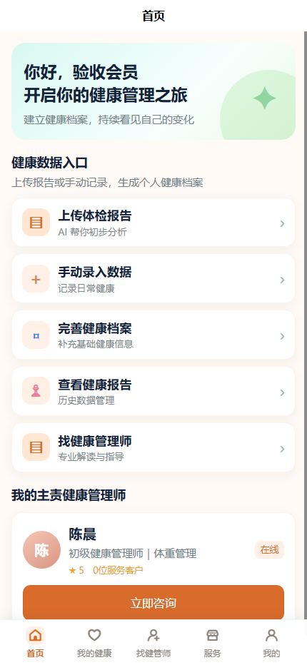

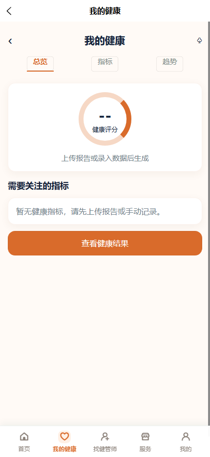

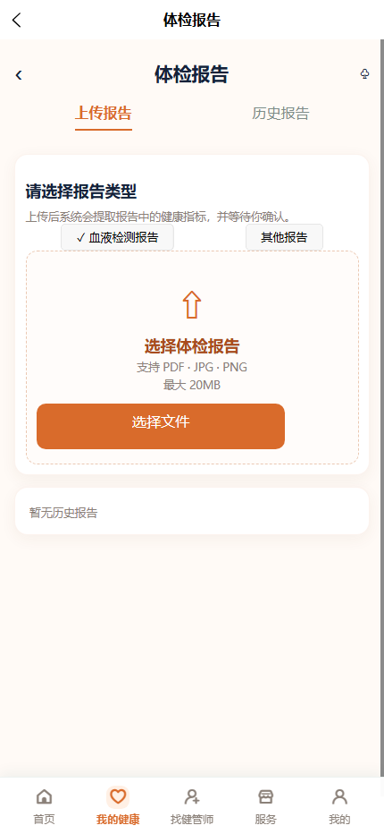

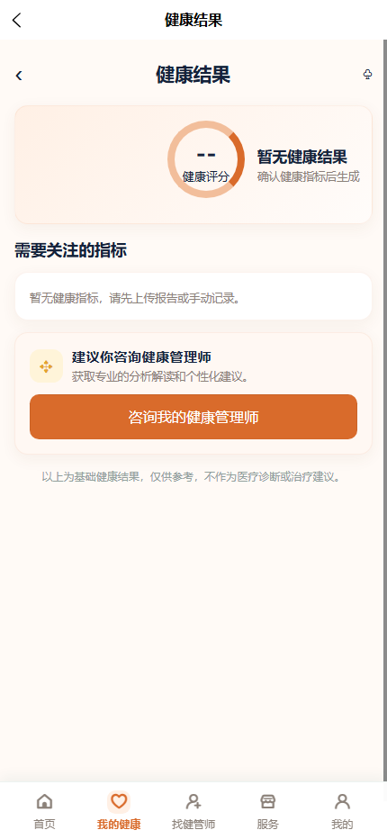

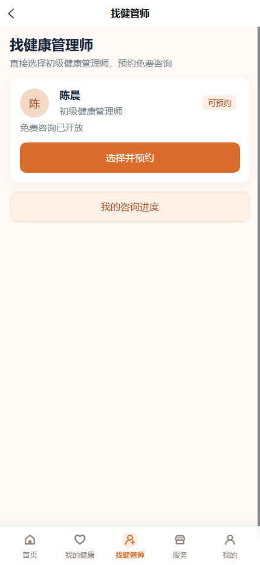

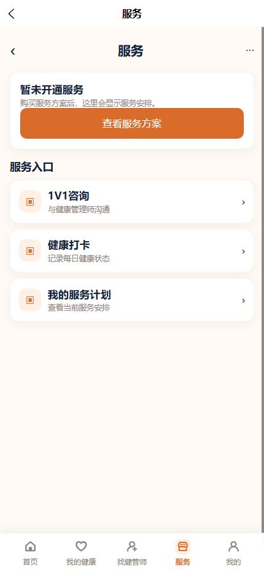

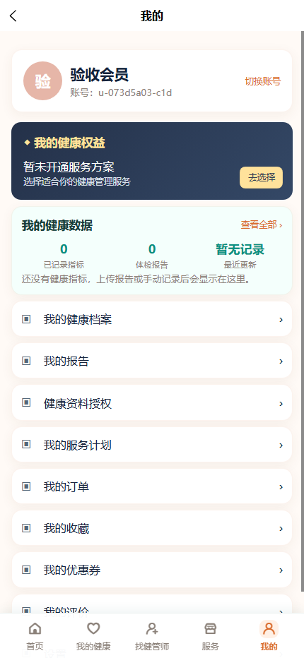

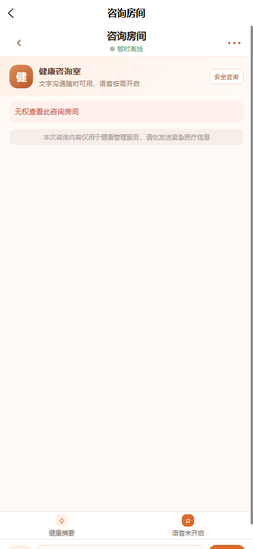

### 健管師端

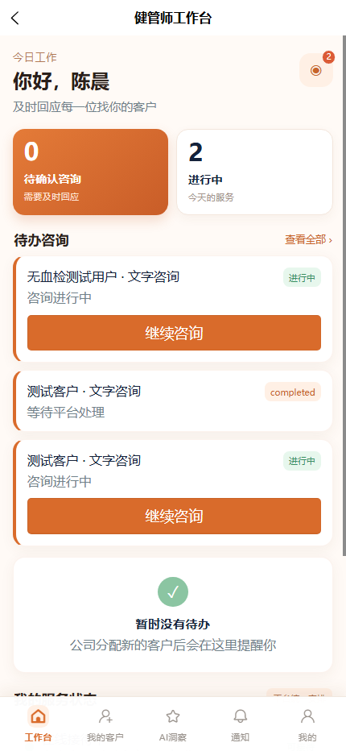

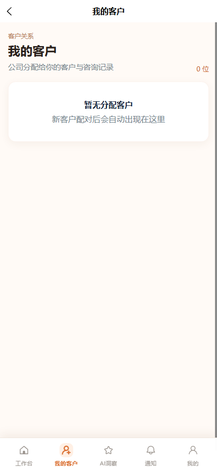

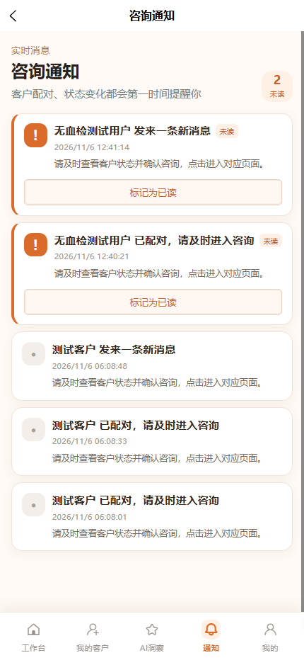

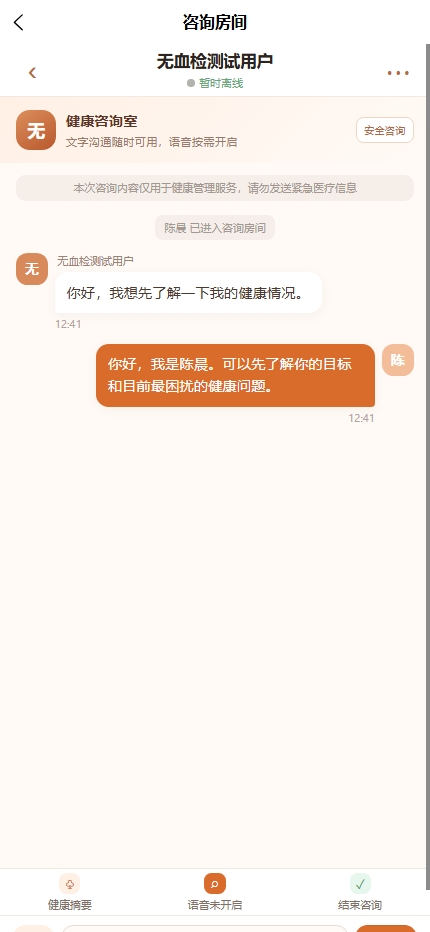

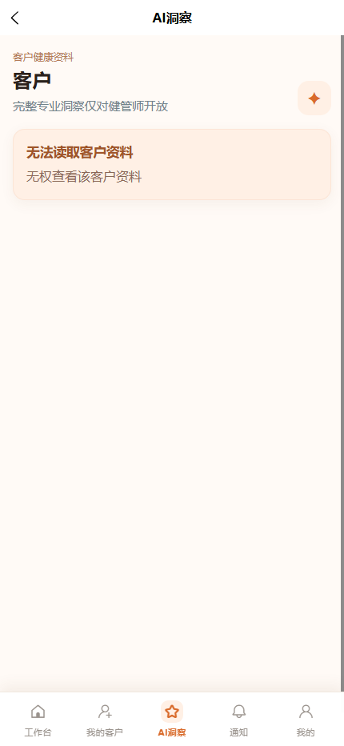

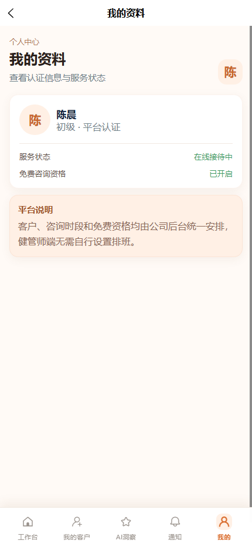

### 管理端

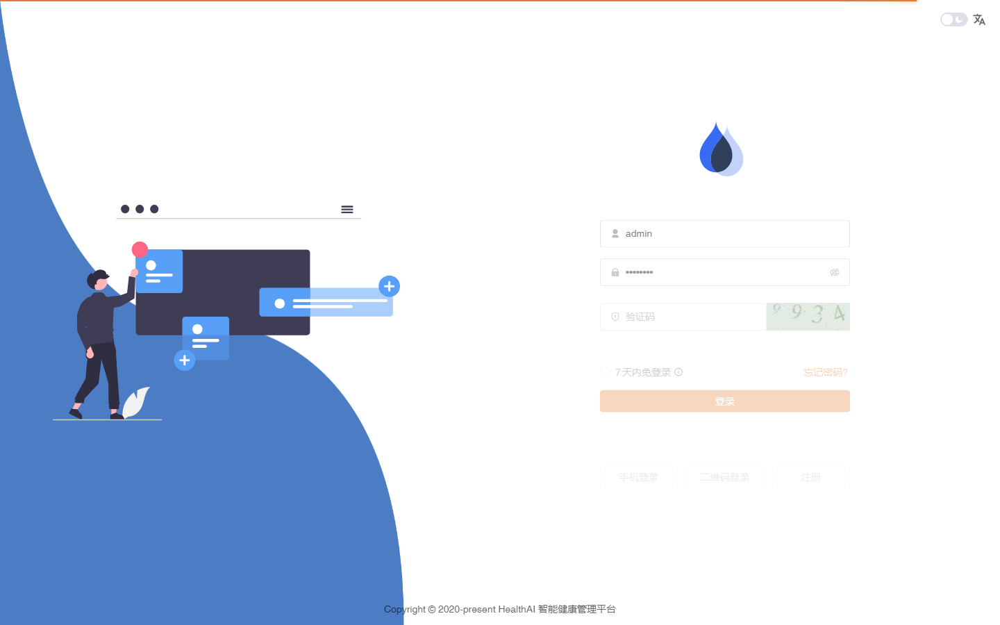

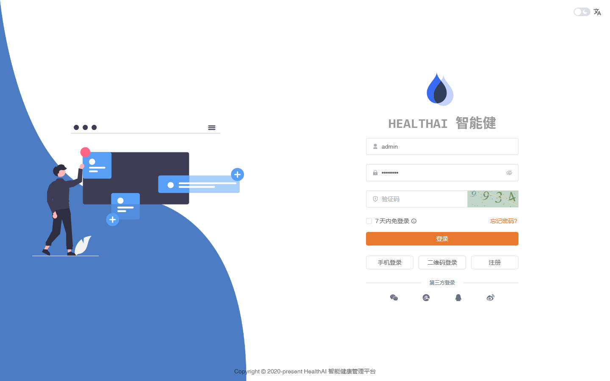

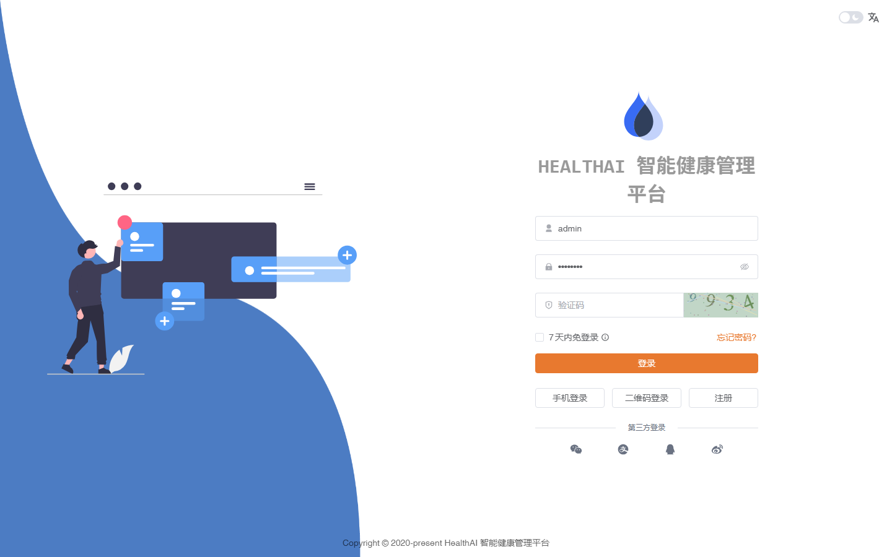

## 四、目前可驗收與不可驗收

| 模組 | 狀態 | 說明 |
|---|---|---|
| Email 會員註冊/登入 | 通過 | 新會員可建立帳號，登入後資料為空白 |
| 微信登入 | 待小程序環境 | H5 不支援微信原生登入，需在微信小程序測試 |
| 健康資料授權 | 通過 | 未授權時會阻止需要健康資料的操作 |
| PDF/PNG/JPG 報告上傳 | API 已支援 | 需用真實檔案再做一次線上瀏覽器驗收 |
| OCR | 待正式 Provider 驗證 | 目前仍需確認正式 OCR 服務與金鑰 |
| AI 分析 | 待正式 Key/模型驗證 | Provider 架構已接好，需確認線上環境實際回應 |
| 健管師匹配 | API 測試通過 | 可指定/自動分配，並有通知流程 |
| 會員與健管師文字聊天 | API 測試通過 | 可讀取與發送訊息；目前非完整 WebSocket |
| 語音 | 未開啟 | 目前不列入本次通過範圍 |
| 管理後台 | 登入保護通過 | 內頁需用正式管理員帳號再驗收 |
| 測試資料清理 | 未通過 | 健管師端仍看到測試客戶/測試諮詢 |

## 五、驗收判定

本次判定：**核心流程可測試，但尚未正式驗收通過**。

正式交付前必須完成：

1. 清除或隔離所有測試客戶、測試諮詢與測試訂單。
2. 提供正式管理員帳號，驗證管理後台的客戶、健管師、訂單與內容管理頁。
3. 用一個真實新會員上傳 PNG 或 PDF，確認 OCR → 指標確認 → AI 分析 → 健管師查看資料完整通過。
4. 用兩個獨立正式測試帳號完成會員與健管師雙向聊天。
5. 確認正式資料庫、OCR、AI Provider 與錯誤監控配置。
