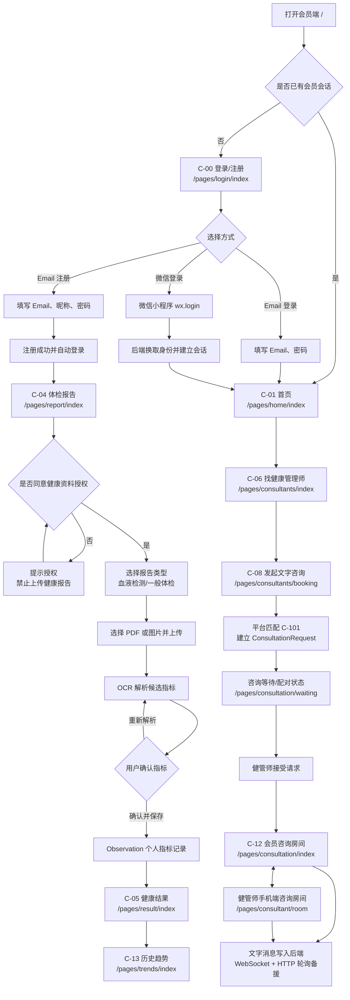

# 一般会员注册与使用流程验收

## 1. 验收范围

本文件记录一般会员从注册到进入健管师文字咨询房间的页面流程，以及后端实际 API 验收结果。

当前会员登录方式：

- Email 注册／登录：H5 与微信小程序均可作为当前验收入口，Email 注册暂不要求验证码。
- 微信登录：只在微信小程序运行环境使用；H5 页面会保留入口，但不能伪造微信授权。

## 2. 页面流程图



## 3. 页面与 API 对照

| 顺序 | 页面 | 主要动作 | 后端接口/资料 |
| --- | --- | --- | --- |
| 1 | `C-00 /pages/login/index` | Email 注册、Email 登录、微信登录入口 | `/api/v1/auth/customer-register`、`/api/v1/auth/customer-login`、`/api/v1/auth/wechat-login` |
| 2 | `C-01 /pages/home/index` | 查看首页与健康入口 | `/api/v1/home-entries`、用户会话 |
| 3 | `C-04 /pages/report/index` | 同意授权、选择报告类型、选文件 | `/api/v1/health/consents`、`/api/v1/health/reports` |
| 4 | `C-05 /pages/result/index` | 查看基础健康结果 | `/api/v1/health/observations`、`/api/v1/health/ai-reports` |
| 5 | `C-13 /pages/trends/index` | 查看历史指标趋势 | `/api/v1/health/trends` |
| 6 | `C-06 /pages/consultants/index` | 查看可用健管师 | `/api/v1/consultation-directory` |
| 7 | `C-08 /pages/consultants/booking` | 发起文字咨询 | `/api/v1/consultation-requests` |
| 8 | `/pages/consultation/waiting` | 查看配对状态 | `/api/v1/consultation-requests` 轮询 |
| 9 | `/pages/consultation/index` | 会员发送与接收文字 | `/api/v1/conversations/:id/messages`、WebSocket |
| 10 | 健管师工作台/房间 | 查看通知、接受咨询、回复会员 | `/api/v1/consultation-notifications`、`/api/v1/consultation-requests/:id/accept`、消息接口 |

## 4. 实际测试结果

### 4.1 自动整合测试

执行命令：

```bash
pnpm test:api
```

结果：`1/1 passed`。

已实际验证：

1. Email 注册返回 HTTP `201`，注册后自动取得会员 Token。
2. 新会员健康档案为空：`profile = null`。
3. 使用刚注册的 Email／密码重新登录返回 HTTP `200`。
4. 未同意健康资料授权时上传被拒绝：HTTP `403`，错误码 `HEALTH_DATA_CONSENT_REQUIRED`。
5. 同意授权后可以上传血检报告。
6. 报告解析产生候选指标，用户确认后写入 Observation。
7. 会员可以生成基础 AI 健康结果，但不会取得健管师专用完整 Insight。
8. 会员发起文字咨询后自动匹配 `c-101`。
9. 健管师可以读取客户资料、通知并接受咨询。
10. 会员发送的文字消息可以被健管师读取。
11. Admin 可以查看咨询房间与消息，但只能查看，不能伪装成参与者发送消息。
12. 无关会员读取该房间会返回 HTTP `403`。

### 4.2 其他已完成测试

| 测试 | 结果 |
| --- | --- |
| 咨询业务规则测试 | `8/8 passed` |
| 生产就绪测试 | `3/3 passed` |
| 主 App TypeScript | 通过 |
| H5 production build | 通过 |
| Admin TypeScript | 通过 |
| Admin production build | 通过 |
| Cloudways `41ca87a` 自动部署 | Success |
| Cloudways `41ca87a` 手动 Redeploy | Success |

## 5. 验收边界与尚未宣称完成的部分

- 自动整合测试使用独立测试资料和测试服务器，不会污染 Cloudways 正式数据库。
- 目前已确认后端聊天链路与权限正确；正式线上双账号聊天仍应使用一组真实会员账号和一组真实健管师账号做最后人工验收。
- 文字聊天目前可用；语音仍未接真实通话 Provider。
- 微信登录必须在微信小程序中验收，H5 不能直接完成微信授权。
- 报告 OCR 是否成功取决于 Cloudways 的正式 OCR Provider 与 API Key；未配置时不会伪造解析结果。

